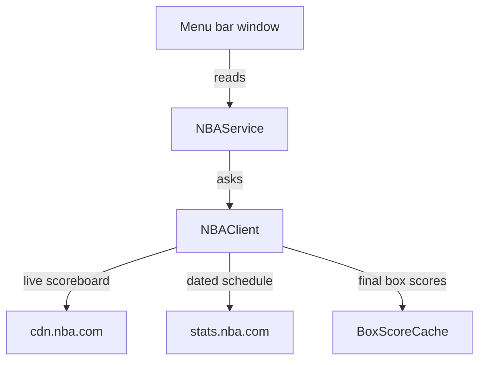

# NBA Score Tracker

NBA Score Tracker is a macOS menu bar app for NBA scores and player leaders.

## Install

On macOS 13 or later, install the signed app from GitHub Releases.

The [latest release](https://github.com/nayeemrahman13/nba-score-track-mac/releases/latest) includes a zip named `NBAScoreTracker` plus the version, such as `NBAScoreTracker-1.0.4.zip`.

1. Download that zip.
2. Unzip it. The app inside is `NBAScoreTracker.app`.
3. Move `NBAScoreTracker.app` into the Applications folder.
4. Open the app.

Later versions arrive through the app's own update check.

## What it shows

The menu bar lists five local days.

A live game or a final game can show player leaders.

## Why the score stays current

The league publishes an unofficial scoreboard and an unofficial box score. The scoreboard names the games and their tipoff times. The box score can be minutes ahead of the scoreboard. The scoreboard can still list a game as live after the game has ended.

The app keeps the later of those two states. It does not replace that state with an older score.

[Score behavior](docs/behavior.md) defines the comparison. The endpoints can change without notice.

## How the pieces fit

The menu bar window reads `NBAService`.

`NBAService` asks `NBAClient` for each date.

`NBAClient` reads the live scoreboard from `cdn.nba.com`.

It reads `stats.nba.com` for a dated schedule and for national TV.

Final box scores are stored in `BoxScoreCache`.

Polling intervals, byte limits, and the cache rules stay in [Score behavior](docs/behavior.md).

## Change the app

Use these pages to build or publish the app.

- [Build and check the app](docs/build.md) covers compiling the app and running the regression executable.
- [Score behavior](docs/behavior.md) is the reference for dates, polling, the cache, and the window.
- [Prepare a public release](docs/releases.md) explains signing, notarization, and Sparkle.
